  

   
   

  

    
    &nbsp;
    
    &nbsp;
    
    &nbsp;
    
  

  

    <a href="#projects"><code>Projects</code></a> &nbsp;·&nbsp;
    <a href="#about"><code>About</code></a> &nbsp;·&nbsp;
    <a href="#skills"><code>Skills</code></a> &nbsp;·&nbsp;
    <a href="#activity"><code>Activity</code></a> &nbsp;·&nbsp;
    <a href="#guestbook"><code>Guestbook</code></a> &nbsp;·&nbsp;
    <a href="#contact"><code>Contact</code></a>
  

---

## Projects

Click <b>Inspect highlights</b> inside any card to explore architecture, engineering decisions, and live links.

<table width="100%">
  <tr>
    <td width="50%" valign="top">
      <code>Developer · 2026</code>
      <h3><a href="https://github.com/cjgdizon/PennyWise">PennyWise ↗</a></h3>
      
A personal finance app for tracking spending, budgets, bills, and savings offline.

      
<code>React</code> <code>TypeScript</code> <code>Tailwind CSS</code> <code>PWA</code> <code>IndexedDB</code>

      

        <a href="https://pennywise-pi.vercel.app"><b>Live ↗</b></a> &nbsp;·&nbsp;
        <a href="https://portfolio-nine-coral-djuqwwvzib.vercel.app/projects/pennywise">Case study ↗</a> &nbsp;·&nbsp;
        <a href="https://github.com/cjgdizon/PennyWise">Source ↗</a>
      

      

        
Inspect highlights

        <ul>
          <li>Browser-local persistence via <b>Dexie (IndexedDB)</b> — no signup or bank connection required.</li>
          <li>Separate accounts, transfers, category budgets, and bill payments linked to expenses.</li>
          <li>Savings goals reserve funds without counting as spending; integer-based money math with guarded DB migrations.</li>
          <li>Filtered CSV exports, printable PDF reports, and backup imports with conflict previews.</li>
        </ul>
      

    </td>
    <td width="50%" valign="top">
      <code>Full-stack developer · 2026</code>
      <h3><a href="https://github.com/cjgdizon/perfume-store">AMIRA ↗</a></h3>
      
An online perfume store with real batch-level inventory tracking and concurrency locks.

      
<code>Angular</code> <code>Spring Boot</code> <code>Java</code> <code>MySQL</code> <code>Docker</code>

      

        <a href="https://amira-perfume-store.vercel.app"><b>Live ↗</b></a> &nbsp;·&nbsp;
        <a href="https://portfolio-nine-coral-djuqwwvzib.vercel.app/projects/amira">Case study ↗</a> &nbsp;·&nbsp;
        <a href="https://github.com/cjgdizon/perfume-store">Source ↗</a>
      

      

        
Inspect highlights

        <ul>
          <li>Stock reserved on order, deducted on payment, restored on cancel — protected with <b>database locks</b> so two buyers can't take the last bottle.</li>
          <li>Owner dashboard reporting expiring, low-stock, and slow-moving perfume batches.</li>
          <li>Customer and owner roles with BCrypt hashing and one-time password-reset links.</li>
          <li>Full stack starts with <code>docker compose up</code>; full integration test covering order → pay → cancel.</li>
        </ul>
      

    </td>
  </tr>
  <tr>
    <td width="50%" valign="top">
      <code>Group Project · 2026</code>
      <h3><a href="https://github.com/cjgdizon/BrightSmile">BrightSmile (DentaSync) ↗</a></h3>
      
Scheduling, dental charts, and online booking for a three-branch dental practice.

      
<code>Next.js</code> <code>TypeScript</code> <code>PostgreSQL</code> <code>Drizzle ORM</code> <code>Playwright</code>

      

        <a href="https://brightsmile.pro"><b>Live ↗</b></a> &nbsp;·&nbsp;
        <a href="https://portfolio-nine-coral-djuqwwvzib.vercel.app/projects/dentasync">Case study ↗</a> &nbsp;·&nbsp;
        <a href="https://github.com/cjgdizon/BrightSmile">Source ↗</a>
      

      

        
Inspect highlights

        <ul>
          <li>Multi-branch chair calendar modeling visit durations and chair cleaning buffers.</li>
          <li>Tooth-by-tooth dental treatment charting plus waiting-room QR intake forms with per-visitor rate limits.</li>
          <li>Role-based access control (owner, manager, staff) backed by an audit log on Supabase Postgres & Vercel.</li>
          <li>Unit, database, and Playwright E2E test suites covering a complete patient visit.</li>
        </ul>
      

    </td>
    <td width="50%" valign="top">
      <code>Hackathon · AppBuildersPH 2026</code>
      <h3><a href="https://github.com/cjgdizon/HACKATON-LubakAlert">Lubak Alert ↗</a></h3>
      
An offline pothole warning PWA — YOLOv8n AI runs on the phone, zero internet needed.

      
<code>TypeScript</code> <code>PWA</code> <code>ONNX Runtime</code> <code>Node.js</code> <code>Python</code>

      

        <a href="https://portfolio-nine-coral-djuqwwvzib.vercel.app/projects/lubak-alert"><b>Case study ↗</b></a> &nbsp;·&nbsp;
        <a href="https://github.com/cjgdizon/HACKATON-LubakAlert">Source ↗</a>
      

      

        
Inspect highlights

        <ul>
          <li>Runs <b>YOLOv8n</b> on-device via <code>onnxruntime-web</code> (WebGPU with WASM fallback); no camera frames leave the phone.</li>
          <li>Confirms detections with accelerometer & GPS, detecting potholes in 62/67 held-out positive test photos.</li>
          <li>Relays hazards to nearby riders via a local Wi-Fi hotspot hub (HTTPS/WebSocket), warning ~6 seconds ahead.</li>
          <li>330+ automated tests plus a two-phone rehearsal run in CI.</li>
        </ul>
      

    </td>
  </tr>
  <tr>
    <td width="50%" valign="top">
      <code>Personal Project · Latest</code>
      <h3><a href="https://github.com/cjgdizon/crown-chess">Crown Chess ↗</a></h3>
      
Modern client-side chess web app powered by chess.js and Stockfish 17.1 WASM.

      
<code>React</code> <code>TypeScript</code> <code>Tailwind CSS</code> <code>chess.js</code> <code>Stockfish WASM</code>

      

        <a href="https://github.com/cjgdizon/crown-chess"><b>Source ↗</b></a>
      

      

        
Inspect highlights

        <ul>
          <li>Runs <b>Stockfish 17.1</b> directly in the browser via WebAssembly — zero backend latency.</li>
          <li>Full legal move validation, board state management, and game flow handled with <code>chess.js</code>.</li>
          <li>Responsive React + TypeScript + Tailwind CSS interface designed for clean, distraction-free play.</li>
        </ul>
      

    </td>
    <td width="50%" valign="top">
      <code>Solo Project · 2026</code>
      <h3><a href="https://github.com/cjgdizon/tetris">Tetris Battle ↗</a></h3>
      
A competitive Tetris game for Windows: you against a configurable bot.

      
<code>Python</code> <code>pygame</code> <code>pytest</code>

      

        <a href="https://portfolio-nine-coral-djuqwwvzib.vercel.app/projects/tetris-battle"><b>Case study ↗</b></a> &nbsp;·&nbsp;
        <a href="https://github.com/cjgdizon/tetris">Source ↗</a>
      

      

        
Inspect highlights

        <ul>
          <li>Modern guideline mechanics: SRS rotation with wall kicks, 7-bag generator, hold, ghost piece, and 5-piece preview.</li>
          <li>Garbage sending & cancelling, T-spins, combos, back-to-back bonuses, perfect clears, and escalating gravity every 30s.</li>
          <li>Configurable controls, handling (DAS, ARR, soft drop), and bot speed via settings, tested with <code>pytest</code>.</li>
        </ul>
      

    </td>
  </tr>
</table>

  
<b>▸ Browse all 9 public repositories</b>

   

| Repository | Description | Primary |
| :--- | :--- | :--- |
| [`crown-chess`](https://github.com/cjgdizon/crown-chess) | Modern client-side chess web app with React, chess.js, and Stockfish 17.1 WASM | `TypeScript` |
| [`Portfolio`](https://github.com/cjgdizon/Portfolio) | Personal portfolio website (`cjd.`) showcasing projects, skills, and case studies | `TypeScript` |
| [`PennyWise`](https://github.com/cjgdizon/PennyWise) | Offline-first personal finance, budgeting, and savings PWA backed by IndexedDB | `TypeScript` |
| [`BrightSmile`](https://github.com/cjgdizon/BrightSmile) | Three-branch dental clinic scheduling, charting, and QR booking system | `TypeScript` |
| [`perfume-store`](https://github.com/cjgdizon/perfume-store) | AMIRA — full-stack perfume storefront with batch inventory locks | `Angular / Spring` |
| [`HACKATON-LubakAlert`](https://github.com/cjgdizon/HACKATON-LubakAlert) | Offline on-device YOLOv8n pothole warning PWA for AppBuildersPH 2026 | `TypeScript` |
| [`tetris`](https://github.com/cjgdizon/tetris) | Competitive Windows Tetris vs. bot with SRS, T-spins, and DAS/ARR tuning | `Python` |
| [`todo-app`](https://github.com/cjgdizon/todo-app) | Clean task management application built in TypeScript | `TypeScript` |
| [`cjgdizon`](https://github.com/cjgdizon/cjgdizon) | This interactive GitHub profile README, custom SVG visuals & GitHub Actions | `Markdown / SVG` |

---

## About

### The developer behind the work.

> I'm an Information Technology student at **Mapúa University**. I build complete software, from the database to the interface — including a perfume store with concurrency-safe inventory tracking, a multi-branch dental practice system, and an offline pothole warning app built for a local AI hackathon.
>
> I'm currently looking for an **internship** where I can contribute to working software and learn from experienced engineers.

  
<b>▸ Experience & education</b>

   

| Period | Role / Program | Organization |
| :--- | :--- | :--- |
| `2024 – 2027` | **B.S. in Information Technology** | Mapúa University |
| `2026` | **AppBuilder 2026 Hackathon** — Local AI Track (`Lubak Alert`) | AppBuildersPH |

  
<b>▸ What I build — end-to-end capabilities</b>

   

| Pillar | Pipeline | Focus |
| :--- | :--- | :--- |
| **Storefronts** | `Catalog → checkout` | Real inventory reservations, concurrency locks, batch reporting, and clean buyer/owner workflows. |
| **Booking systems** | `Branches → appointments` | Multi-branch chair calendars, QR intake flows, rate-limited public forms, and role-based audit logs. |
| **Full-stack development** | `Interface → database` | Accessible frontends, typed APIs, relational schemas, offline-first PWAs, and automated E2E/unit test suites. |

---

## Skills

### Tools & continued learning.

<table width="100%">
  <tr>
    <td width="50%" valign="top">
      <h4>Frontend</h4>
      

        
        
        
        
        
        
        
      

    </td>
    <td width="50%" valign="top">
      <h4>Backend</h4>
      

        
        
        
        
        
        
        
        
      

    </td>
  </tr>
  <tr>
    <td width="50%" valign="top">
      <h4>Languages</h4>
      

        
        
        
        
        
      

    </td>
    <td width="50%" valign="top">
      <h4>Tools & testing</h4>
      

        
        
        
        
        
        
        
      

    </td>
  </tr>
</table>

  
<b>▸ Certifications (19) — Verified Coursera coursework</b>

   
  Full-size certificates are also viewable on the <a href="https://portfolio-nine-coral-djuqwwvzib.vercel.app/#skills">portfolio skills page ↗</a>.
    

| Certificate | Issuer | Date |
| :--- | :--- | ---: |
| Angular for Front End Engineers | Codio · Coursera | `Oct 2026` |
| User Experience: Research & Prototyping | UC San Diego · Coursera | `Oct 2026` |
| AI For Everyone | DeepLearning.AI · Coursera | `Sep 2026` |
| Information Security Fundamentals | EC-Council · Coursera | `Sep 2026` |
| Foundations of Agile Project Management | Google · Coursera | `Sep 2026` |
| Data Warehouse Concepts, Design, and Data Integration | Univ. of Colorado System · Coursera | `Jun 2026` |
| Visual Elements of User Interface Design | CalArts · Coursera | `Jun 2026` |
| Version Control with Git | Atlassian · Coursera | `Jun 2026` |
| Essential Tools for Application Development | LearnQuest · Coursera | `Jun 2026` |
| Introduction to Data Science in Python | Univ. of Michigan · Coursera | `Feb 2026` |
| Enterprise Systems | Univ. of Minnesota · Coursera | `Nov 2025` |
| An Introduction to Interactive Programming in Python (Part 1) | Rice University · Coursera | `Oct 2025` |
| Data Structures | UC San Diego · Coursera | `Jul 2025` |
| Database Management Essentials | Univ. of Colorado System · Coursera | `Jul 2025` |
| Object Oriented Programming in Java | UC San Diego · Coursera | `Mar 2025` |
| Interactivity with JavaScript | Univ. of Michigan · Coursera | `Mar 2025` |
| Introduction to Contemporary Operating Systems and Hardware 1a | Illinois Tech · Coursera | `Mar 2025` |
| Advanced Styling with Responsive Design | Univ. of Michigan · Coursera | `Feb 2025` |
| Programming for Everybody (Getting Started with Python) | Univ. of Michigan · Coursera | `Oct 2024` |

---

## Activity

  
   
   
  
  &nbsp;
  

 

  
<b>▸ Contribution snake (monochrome titanium · auto-updated daily)</b>

   
  

    <picture>
      <source media="(prefers-color-scheme: dark)" srcset="https://raw.githubusercontent.com/cjgdizon/cjgdizon/output/github-contribution-grid-snake-dark.svg" />
      <source media="(prefers-color-scheme: light)" srcset="https://raw.githubusercontent.com/cjgdizon/cjgdizon/output/github-contribution-grid-snake.svg" />
      
    </picture>
  

---

## Guestbook

Want to say hi or leave feedback? Click <b>Sign the Guestbook</b> below — opening the pre-filled issue triggers a GitHub Action that automatically adds your note here.

  
  &nbsp;
  

<!-- GUESTBOOK:START -->
| Visitor | Note | Date |
| :--- | :--- | ---: |
| [@cjgdizon](https://github.com/cjgdizon) | Welcome — leave a note above to sign the guestbook! | `2026-11-19` |
<!-- GUESTBOOK:END -->

---

## Contact

### Let's build your next project.

Need an online store, a booking system, or a custom web application? Send me your idea, what it needs to do, and where you'd like to take it.

  
  &nbsp;
  
  &nbsp;
  
  &nbsp;
  
  &nbsp;
  

 

  

